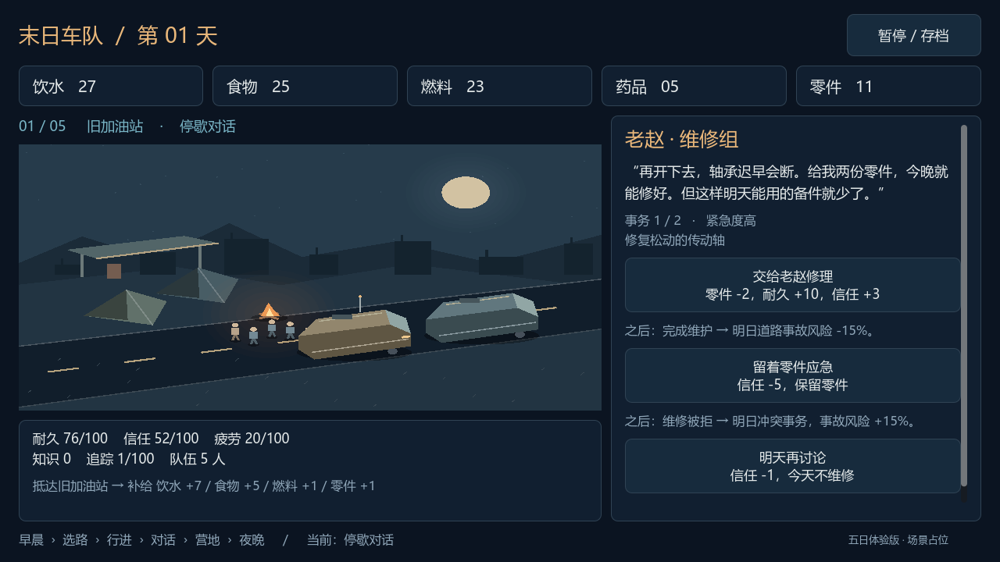
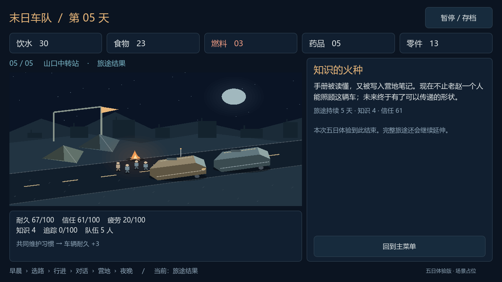
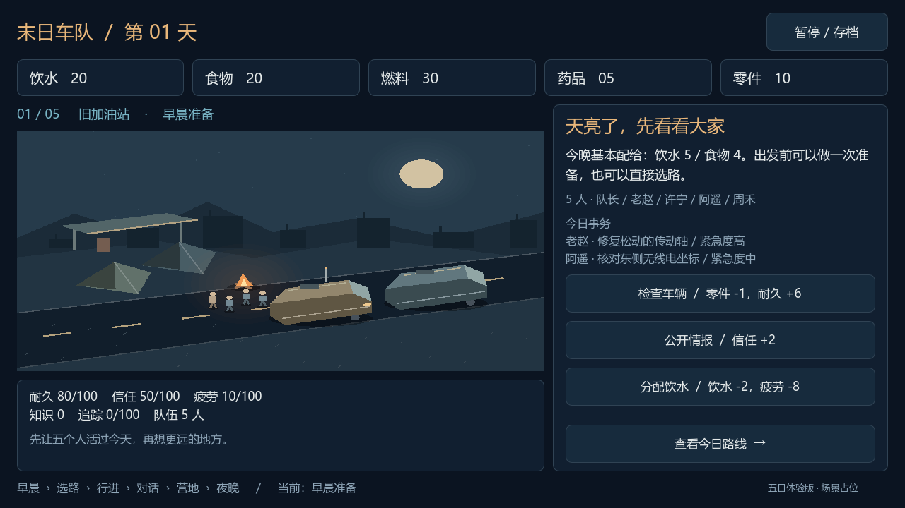
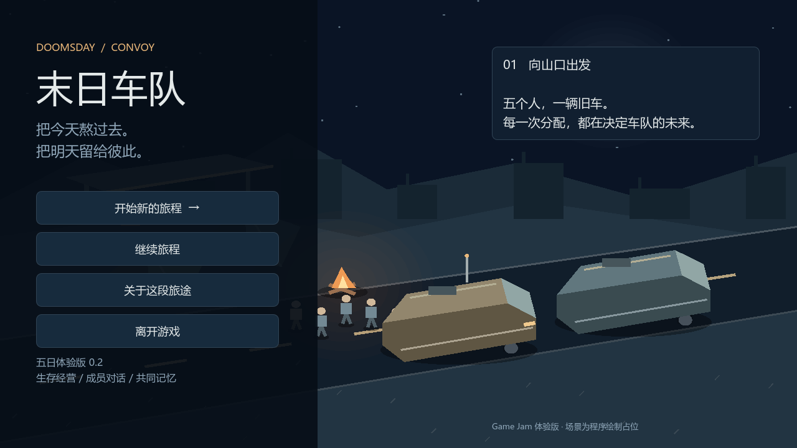
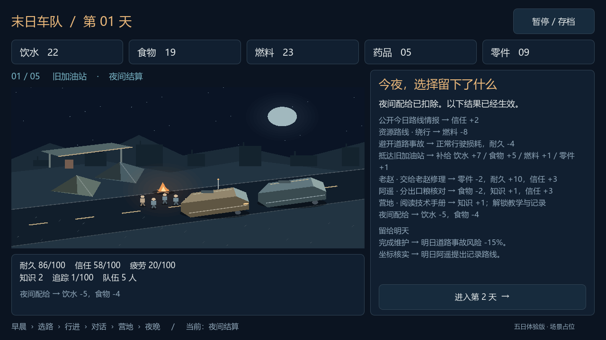

# 2026-10-10｜让选择真正留下后果

这一轮把体验扩展为五天、五处停歇点。重点是让“我做了什么”和“车队变成什么样”对应起来，而不是只把阶段按顺序点过去。

## 从显示效果到实际效果

最先暴露的问题是，界面上写着“维修提高耐久”“阅读增加知识”，实际状态却没有变化；道路事故只是日志，资源耗尽也不会结束。玩家因此无法判断一次决定是否有价值。

现在车辆耐久、成员整体疲劳、知识和怪物追踪都会保存、消耗或增长。资源不够时无法接受请求，行动也不能重复执行来领取收益。夜晚只结算一次配给，不足时进入旅途结果。

## 把 NPC 请求做成真正的队列

原先早晨列出多个请求，到停歇点却统一显示维修请求。现在老赵、阿遥、许宁和周禾会分别提出维修、情报、伤势或饮水事务，每条都有自己的接受、拒绝、延期结果。

昨天答应维修，今天会出现检修分享；昨天拒绝，今天会要求解释分配。饮水紧缺和疲劳积累也会把新的事务推到前面。对话卡在回应之前显示资源代价、即时效果和之后会发生什么，夜间再把这一天串起来复盘。

## 三条路线需要各自的价值

只给路线不同事故率，不足以形成取舍。于是给安全路线少量补给，给资源路线更多物资，给未知路线旧档案与知识。一次调整后又发现资源路线返还的燃料和零件太多，容易成为固定答案，于是降低收益，让它仍然值得冒险，但需要承担燃料与维护压力。

出发前保留三种预设：低噪音控制追踪，快速减少疲劳但增加风险和追踪，绕行多耗燃料却降低事故损伤。七秒自动行进负责表现出发和抵达；道路事故直接损伤车辆，追踪积累会引来异变兽。

这些数值仍属于初步验证，尚不能说明路线已经平衡。

## 给“涌现”一条看得见的小链条

先做了一个范围很小的例子：阅读技术手册 → 教学与记录 → 重复两次形成共同维护习惯 → 每晚额外恢复车辆耐久。

实现时还修正了一个前置漏洞：路线档案增加的知识不能替代技术手册阅读。这样“获得信息”和“学会修车”才有各自的来源。五天后，有共享维护习惯的车队会得到“知识的火种”，其余生存者得到“仍在路上”。

这只是重复行为形成习惯的最小例子，尚未做到个人理解、多人传播和完整制度生成。

## 场景与界面的第一轮整理

保持冷蓝废土与暖色篝火的方向，用程序绘制帐篷、人员、旧车、公路和地点标记，避免把图册示意图直接当游戏背景。加油站、隧道、水塔、雪地与山口现在有不同轮廓。

界面改成顶部物资、左侧车队场景和状态、右侧选择、底部每日进度。截图复查发现页脚被挤成竖排，推进按钮也藏在滚动内容下方；随后改成固定页脚和固定推进区，移动预设与最终消耗也持续可见。

## 这轮验证与后续重点

通过 52 项规则检查和 70 项界面流程检查（包含主菜单实际指针点击），完成五日流程验证，检查了资源不足、重复行动、次日事务、配给失败、车辆与关系失败、暂停、保存覆盖、读取和行进恢复，并渲染检查普通、窄横屏及宽横屏布局。

当前仍是程序美术和面板玩法。下一轮最需要补的是休息点中队长走动、接近队员并交谈，让核心对话发生在营地空间里。成员目前还用整体疲劳表达，个人健康、招募、车辆成长、正式音画和安卓真机体验都需要继续做。
