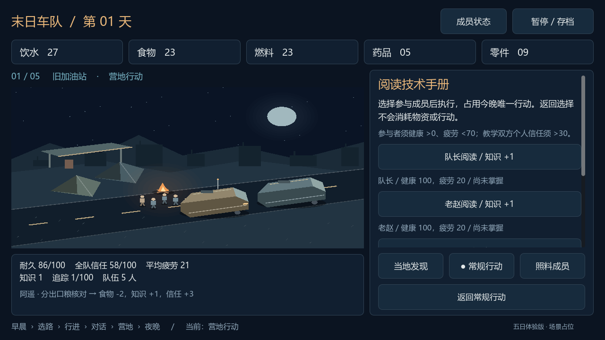
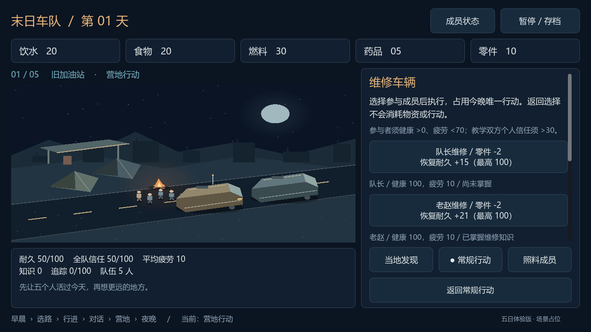

# 2026-10-11｜一份手册如何变成大家的本事

过去只要点过阅读，再点两次教学，车队就会形成共同维护习惯。这个闭环能跑通，却说不清谁读懂了手册、教给了谁，以及知识为何能让车修得更好。本轮把这条因果链落实到具体成员。

## 先决定把书交给谁

常规行动中的阅读现在先打开成员选择。只有选定读者才执行当晚行动，返回或切换营地页签都不扣物资。读者会记录“掌握维修知识”和来源“技术手册”，其他人不会同时学会。

健康归零或疲劳达到 70 的成员不能承担阅读、教学或维修。教学还要求教师和学员的个人信任都大于 30。这些门槛会在选择前显示，不合格成员禁用；没有合适人选时仍能返回，选择照料或休息。

## 教学要让另一位成员真正学会

教学先选已掌握知识的教师，再选尚未掌握的学员。学员记录教师姓名，之后也可以继续教学，支持“老赵读手册 → 队长学习 → 队长教许宁”的传播链。成员总览和夜间复盘都能查看来源。

重复阅读、向自己教学或再教已经掌握的成员，都不会增加知识或教学进度。共同维护要求至少三人掌握，并有两位不同的新学员通过教学掌握；条件满足后沿用每晚耐久 +3 和五日“知识的火种”结果。路线档案仍不能替代维修手册。

## 知识怎样改变实际工作

营地维修也先选择执行者。同样消耗两个零件，普通成员恢复 15 点耐久，掌握维修知识的成员恢复 21 点。按钮按车辆当前耐久显示实际可恢复量：耐久已经 95 时只显示 +5，避免把上限之外的收益也算给玩家。

这仍占用当晚唯一行动。学习、传授、修车、补给和休息之间的取舍继续存在；对话中的维修和早晨检查暂时保持原数值。

## 保住过去的进度，也拒绝不成立的状态

存档仍使用版本 2。旧档没有个人知识字段时，将原有阅读进度交给老赵，按固定成员顺序补全最多两位不同学员；已经形成的共同维护可以继续生效。新档保存真实来源，局部缺字段、错误类型、非法教师和循环来源都会被拒绝。

检查时还发现，只验证个人字段不足以阻止损坏存档直接设置“共同维护”。现在恢复前同时检查掌握人数、教学次数和实际学员数量；不成立就拒绝，当前游戏状态保持完整。尚未执行的选人界面不属于已完成行动，读档后回到正常入口。

## 验证与下一步

Godot 4.7.2 编辑器导入通过；使用仓库原版项目配置的隔离副本也完成了同一轮验证。规则检查 196 项、主界面检查 254 项、独立知识界面检查 185 项通过，其中知识界面的 6 项是图形截图保存检查。覆盖五日完整流程、多代教学、重复和跨阶段操作、无资格或缺零件时的原子拒绝、旧档迁移、知识来源存读档和共同维护坏档拒绝。

实际渲染检查了 1280×720、960×600、1560×720。成员列表可以滚动，返回、重新选择教师和营地页签保持在固定操作区；真实鼠标点击也验证了取消、选人、维修和读档。本文保留读者选择、成员来源和维修差异三张截图，后两张来自专门构造的知识界面测试场景。

本轮先完成维修手册这一种知识和营地维修效果。其他书籍类别、医疗 / 侦察 / 后勤效率、正式职业形成与地点分支还未展开；安卓真机、正式音画和长期数值平衡仍待验收。下一步可以让其他知识也形成可追踪的传播链，再评估岗位之间的差异。
