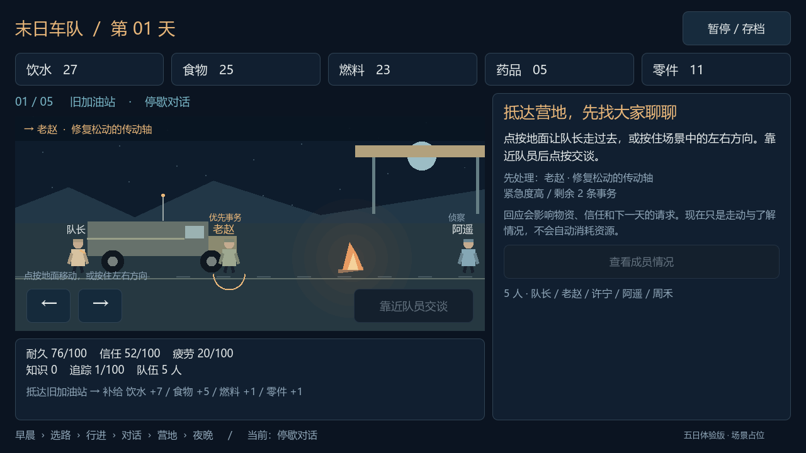
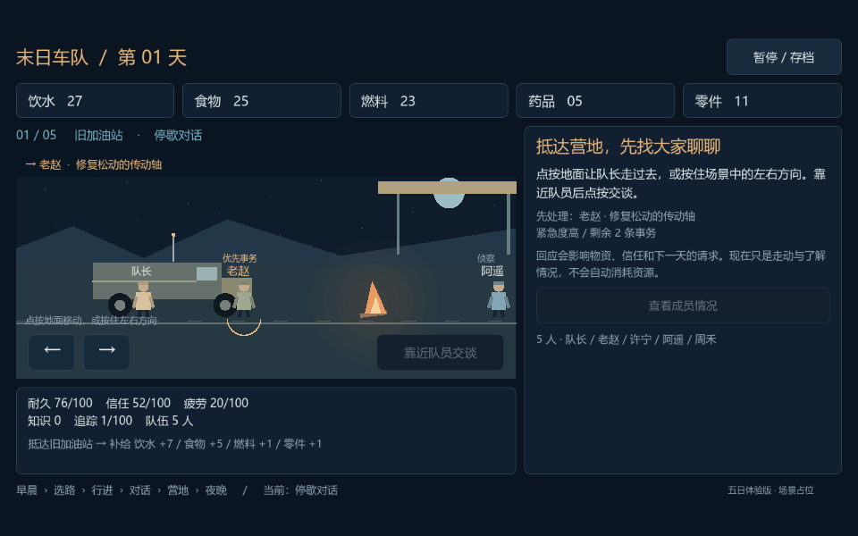

# 2026-10-11｜把对话放回营地

上轮已经让选择产生真实后果，这轮希望让它们发生在一个能走进去的地方。抵达停歇点后，不再自动弹出维修请求，而是先看到车、篝火和分散在营地里的四位队员。

## 一次对话的进入方式

队长可以点按地面走过去，也可以按住屏幕上的左右方向。走近队员后交谈，右侧才显示请求与回应；回应完成后回到场景，再去找下一位队员。镜头跟随队长，车旁、地图旁、医疗帐篷和物资区分别对应不同岗位。

事务仍按优先队列处理。想先看看其他队员也可以，场景会显示近况，但不会把高优先级请求跳过去。先做这条限制，是为了继续验证每日两到三件事的节奏；完全自由的事务排序还没有实现。

## 交谈应该是一次明确停下

开始交谈后，队长停止走动；玩家也可以先结束交谈，回到营地考虑一下。这里的“结束交谈”只是关闭面板，不会把请求当作拒绝或延期，也不会消耗一次事务。真正按下回应，才写入今天的因果。

角色靠近时留出站位，避免队长与队员叠在一起。场景上方用方向和名字提示当前要找谁，靠近后交谈按钮才可用。

## 移动比想象中更容易卡住

方向控制需要记住每根手指，不能只用一个“正在按右键”的标记。两根手指同时按相反方向会抵消，松开一根后另一根仍继续生效。松手发生在场景外也要接收到，否则队长就会一直走。暂停和切出窗口也会清空按住状态。

另一个问题出现在窄横屏：刚从赶路切回营地时，场景还没收到容器的新尺寸，第一次点击使用了旧的镜头偏移。结果点同一块地面，队长却走到别处。修正方式是尺寸变化时更新镜头，并在处理点击前再次同步坐标。

## 读档不应该把人送回入口

存档现在保留队长的营地位置，以及是否正在交谈。读回来可以继续当前请求，而不是再走一遍。早期五日版本的存档没有这些字段，就从入口恢复，已有的资源、天数和事务结果继续保留。

## 当前结果

本轮通过 66 项规则检查和 117 项界面检查，跑完五天，同时检查了靠近交谈、返回探索、多指输入、场景外松手、暂停、位置与对话恢复，以及普通、窄、宽横屏下的实际渲染和点击坐标。这些仍是本机验证，安卓真机尚未验收。

现在营地已有走动与接近交谈的基础体验，但视觉仍是程序绘制占位。下一步需要让成员拥有自己的状态，让加油站、水塔、隧道等地点提供不同的事务与资源选择；否则玩家走到不同地方，仍只是在重复同一套事情。
