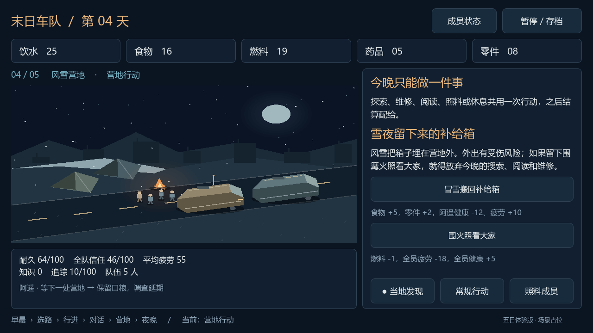

# 2026-10-11｜每个人的代价与每个地点的选择

营地能走动后，下一件事是让队员不再只是请求的名字，让加油站、水塔和雪地也不再只换一个地标。

## 平均疲劳掩盖了谁在承担负担

过去全队只有一个疲劳值。现在队长、老赵、许宁、阿遥和周禾各自记录健康、疲劳、个人信任及最近记忆。顶部仍保留平均疲劳，详细处境放到成员总览里。

道路事故会让处理车底问题的老赵擦伤，怪物追踪则可能伤到负责掩护的阿遥。阿遥沿途侦察比其他人多积累一点疲劳。健康和疲劳既留在今天，也会让明天的医疗请求关注具体的人。

疲劳达到 70 的成员在夜间损失健康，基础成员健康归零时会结束当前切片。这个门槛在总览中说明，避免只在结算时突然出现惩罚。

## 一份药品，应该照顾谁

许宁的请求现在会写明需要照料的人，使用药品只恢复那个人的健康和疲劳。营地也能直接选定成员照料，但它占用当晚唯一行动：如果今晚照料老赵，就不能再同时修车、读书或休息。

拒绝请求会留在说话者的个人信任与记忆中。个人信任与全队信任分开记录；目前先让老赵的低信任影响分配冲突，完整的成员关系和岗位效率还没有展开。

## 五个地点，十种取舍

每处停歇点各加入两种行动：

- 旧加油站：花零件修泵取油，或拆泵留备件。
- 隧道口：冒险搜索救护车找药，或只取入口的罐头。
- 水塔：烧柴油抽更多水并增加追踪，或让阿遥疲惫地搬水。
- 雪地：冒雪搜补给并承担伤势，或消耗燃料围火照料大家。
- 山口：用零件换口粮，或换测绘档案。

这里没有新增一次免费的探索机会。当地事件、常规行动和照料共用一个名额，才能让眼前补给与长期维护、知识、休息发生冲突。地点结果目前是可见的固定值，先让玩家知道自己承担什么，再考虑更复杂的事件分支。

## 把增加的信息放到容易找到的位置

最初把治疗目标、日常行动和地点事件都塞进右侧列表，结果当地事件藏得太深。随后改为底部三个固定入口：当地发现、常规行动、照料成员。当天地点默认打开，另一种行动也能很快看到。成员总览打开时会暂停移动与赶路。

## 验证与当前边界

本轮通过 134 项规则检查、240 项界面检查，验证了十种当地行动、个人受伤与治疗、成本不足、地点限制、重复领奖、次日医疗、个人低信任、存档及旧档迁移。也跑通了教学形成维护习惯，以及使用五处当地事件完成旅途的两种策略，并渲染检查实际画面。

这还不能说明数值已经平衡。成员初始能力仍相同，个人知识传播、岗位效率、招募和更自由的关系变化尚未完成；地点还通过营地菜单执行，没有场景内拾取机关。接下来最值得做的是把技术手册的知识落实到具体的阅读者和教学者，让共同维护不再只靠全局计数。
