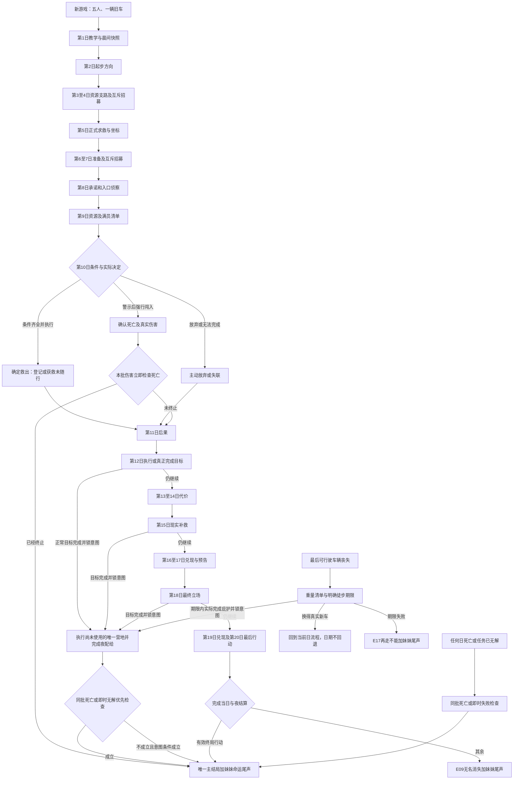

# 《末日车队》整套玩法流程 · 正式定稿

版本：2026年10月15日，已同步五部位三十配件。本文说明玩家从新游戏到结束一局的完整体验。数值、概率与终止顺序共同使用[定稿规则基准](./定稿规则基准.md)；剧情卡正文纳入最终剧情总稿。旧十日原型、城市/城堡等泛化结局、妹妹获救立即结束和自由手动回档均由本版替代。本轮交付设计文档，游戏代码接入另行实施。

## 1. 开局、目标与画面

安卓横屏单机，HD-2D。旅途、大地图和状态面板采用俯视，营地走动、交谈和谈判采用侧视。旅途自动移动，玩家在出发前作安排，在突发时执行短促反应；自由走动只用于停歇点，不设计持续驾驶射击关卡。

单局目标45至75分钟。普通日有3至5项核心决定：一次准备、一次路线、最多两项主要事务、一次营地行动。重要节点替代当日主线路线决策，不另送行动次数。最长20天；第12天起，真实完成目标可以提前收束。死亡和已经无解的失败当场结算。

队长与老张、艾琳、阿杰、索菲亚带旧车“老伙计”出发。老张维修70，艾琳医疗75，阿杰侦察65，索菲亚后勤70；队长具备35/35/40/45的维修/医疗/侦察/后勤能力，可以学习接替。成员没有专属超能力，妹妹也是普通可培养成员。最大总人口8，队长计入总人口。

开局水50升、食45人日份、燃料80升、药5剂、零件25件、茶3份、香薰2份；四类书各1册、20页空白笔记本。老张/艾琳/阿杰/索菲亚对本职对应书理解60，其他初始理解0；专业新人对应书50，岑柏/妹妹0。笔记本实体0.5千克，用掉页数不减少实体重量。旧车耐久80、8座、货载300千克，已有可用电台和基础工具。角色健康、疲劳、信任、好感、岗位能力统一0至100。

开场对白：

> 老张：车还能走。别让它替我们把路选了。
>
> 艾琳：先数人。药最后再数。
>
> 阿杰：南边有个旧频段，我只听见过一次。
>
> 索菲亚：五个人。从今天起，每一份都要有名字。

当前目标先是活过今天；第2天发现方向，第5天确认妹妹所在，第8天为承诺准备，第10天实际救援；后半程承担后果，决定车队最终如何生活。旧世界能源设施只承担背景，不另开核武或反应堆主线。

## 2. 每日循环与结算边界

|阶段|玩家实际操作|系统执行|
|---|---|---|
|晨间开始|继续进度，查看昨日因果和危机|生成当日开始自动快照；显示实际人口、配给缺口、车况、截止日|
|一次准备|分水、小修、清账、急救或不行动|分水水2/全队信任+2；小修零件2/耐久+8；清账私藏风险−10；急救药1/目标健康+20；不行动连续3天全队信任−5后计数归零|
|路线与预设|选真实可达路段及低噪音、快速或绕行|显示确定成本、合格风险和预计时间；固定节点在此明确主线意向|
|自动移动|观看旅途，突发时短促反应|普通行驶全员疲劳+6；最多一移动事件；第5、10天以主线场景替代普通移动随机|
|停歇探索与事务|侧视走动，最多两项主要事务；追问再决定|追问只揭示信息；接受/拒绝只结算一次；路边机会占一个事务名额|
|一次营地行动|知识六行动，或维修、照料、当地搜集、仪式、安装模块|基本行动2小时；最多一张相关营地卡，卡为同一行动延伸，不重复基础收益|
|夜间配给|确认已安排配给，阅读因果结果|按实际人口N扣水N/食N；缺口按个人结算；更新疲劳、健康、制度和历史|
|终止检查|继续下一日或观看主结局与妹妹尾声|同批死亡→即时无解→第12日起实际目标完成→第20日兜底；不生成第21天|

准备1小时、普通行驶8小时、营地2小时，共11小时；每日预算12小时。超时全员疲劳增加2×实际超出小时，允许小数，但日期和妹妹救援期限不延长。每天08时为计时起点；进入移动阶段已累计小时加本段预计移动小时超过10才按夜间移动筛选，不用尚未发生的营地行动倒推。成本不足的选项锁定并列明缺项，不用“扣到0”假装付清。

普通交易、贡献、群体决策、玩家安排的安全分流和目标完成各1小时、占主要事务；个人换班及短库存答复0.5小时。明确写出的卡片时间优先，不重复加通用时间。M01拆前桥替代准备共2小时，M02小修替代准备共1小时；完整治疗、T03维修、T07全队休息及N-F04①均替代唯一营地，未单列时间时共2.5小时，可在出发前紧急执行，晚间不再执行第二次。T02/T10个人排班不是全队营地动作。书交换、换车、模块仍占营地；正常完成目标先锁意图，再完成尚未使用的营地和夜间配给。

### 路段、资源与风险

|路段|燃料|耐久损耗|时长|移动整池出现率|确定基础供给|
|---|---|---|---|---|---|
|安全|8|2|8小时|20%|无|
|资源|8|3|8小时|35%|当地供给带内选一：水12/食10/燃料12/零件4/药1|
|未知|6|4|8小时|50%|无；抽中地点卡再按卡取物|
|主动停留|0|0|0小时|0%|没有行驶奖励，主动停留计数+1，全员疲劳+2|

同一物资不可同时作为路段基础供给和事件搜集重复领取。预设低噪音燃料+2/噪音−15；快速燃料+2/时长−2/疲劳额外+4/噪音+15；绕行燃料+3/时长+2，排除道路事故类入池。只有已知地图上确实相邻的节点可达，选择远方目标不直接视为抵达。

地图按章节相邻主边推进：车辆每天走一条30千米主边，快速不多推进一章；绕行多10千米但仍只走一主边；同章补给支路不额外增加主边进度。正常终点至少走完8主边，救援站须第10天且至少6主边、情报3。第12、18、20天可呈现当前章节真实终点入口，只有此前已到本章主边目标才可进入，余下6千米为同日完成动作且已含当日油耗，不再次收路线费。第12日前停留过多会落后，后半程可继续走，但第10救援不延期。

一次当地搜集占营地行动，可从实际地点提供的两项中选一：水18、食16、燃料20、零件6或药2；同地点只领一次。供给带依日次为1–4水/食，5–7燃料/零件，8–10药/食，11–14水/燃料，15–17食/零件，18–20水/药。方向的区域修正提前显示，不给凭空资源。

完整配给疲劳−2；健康≥50、疲劳<80者再健康+2。缺水健康−15/疲劳+10；缺食健康−8/疲劳+5；连续两日缺水额外−10健康、缺食额外−5。健康0死亡；1–29重伤；30–49伤员；疲劳80以上夜间健康−5，95以上不能执行岗位。健康下降不等于立即死亡；车辆耐久低不等于立即报废。

货重与超载在出发前显示；超载禁止出发，可交换、存放或明确丢弃。水1千克/升、食0.5千克/份、油0.8千克/升、药0.1千克/剂、零件1千克/件、书0.5千克/册。最多两辆车；额外车每日油耗+4，各车独立受损，不增加8人上限。

## 3. 从第1天到第20天的整体节奏

以下固定内容只在当局仍继续并进入该日时出现，出现率100%；不是按概率抽取的主线。当天合格随机事务仍按后述算法出现，不保证每天有某张支线。已经结局的路线停止，未到日期不再演出。

|日|职责|玩家会经历什么|当天需看清的后果|
|---|---|---|---|
|1|教学、建立五人基线|晨报、第一次准备和路段、一次停歇交谈、一次营地行动|教会实际人口配给、成本不足锁定和单次行动；无线电只有模糊旧片段|
|2|重要：起步方向|核查旧频段/接触东岸/独立补给三种真实起步行动|核查获得情报1；其他方向不凭空有救援情报；保留第5日补核对机会|
|3|次要：补给取舍|安全、资源或未知路段；供给带水/食|只改变当日资源、耗时及既有风险，不改变第2日主线意向|
|4|次要：风险与招募|当日路段；停歇机会槽必现许宁/陈川互斥候选|招募其中一人水2食2；另一人永久关闭；两人都不收可继续|
|5|重要：正式求救|妹妹固定正式信号、坐标情报1；确认救援准备或转向车队目标|距第10日经过5天；若第2日未核查，可此日零件2补得漏失情报1|
|6|次要：修整与备份|燃料/零件支路；可揭示真实可达废车点|资源和时间取舍；岗位培养、车辆风险前兆开始显现|
|7|次要：维持与第二组招募|路段；旧水塔杜衡/林悦互斥候选固定停歇槽|招募水2食2；不改变主线承诺；把人口配给增加显示到当夜|
|8|重要：明确承诺|侦察南边入口/继续聚落商路或独立方向|南入口燃料4、1小时，情报1且南线承诺；没有这一准备第10不能救援|
|9|次要：救援前清单|药/食支路；查看医疗/侦察状态、可达废车点、岑柏机会|岑柏水2食2且容量允许；岑柏固定100%占停歇机会槽；满员救出妹妹后登记前须选一人安全离队，不预留隐藏席位|
|10|全局最重要：实际救援|逐项验算准备，低声进入/正面突破/放弃/承认无法完成|救援成功确定；不追加妹妹生死骰，不允许当天替代补救，救后继续|
|11|救援后首轮代价|妹妹成为普通伤员或显示其他命运；队伍接纳、休息和资源缺口|新增人口按当夜真实成员扣费；不因已救妹妹自动全员同意下一目标|
|12|重要：执行或完成目标|到真实庇护点、商会或继续目标路段；徒步旧期限检查|正常目标首次可收束；徒步未换车必须当夜完成庇护，否则再走不能|
|13|执行反馈|呈现12日行动留下的岗位、配给与关系后果|仍在行进才继续；没有新固定重要节点|
|14|反噬与分歧|承诺到期、伤员、私藏、两群体信任差或知识备份事务|重大失败前显示条件与到期后果；一夜分歧不自动判最终分裂|
|15|重要：现实补救|维持目标/拜访已知聚落贡献/在已接触商会取得第二车|贡献水5食5关系+15；第二车零件12燃料10，后续每日油耗+4|
|16|兑现补救|实际支付15日代价，继续岗位和车况维护|不能清除已有掠夺、死亡或恢复互斥招募；尚未完成目标可继续|
|17|结局压力预告|显示真实剩余距离、关系门槛、配给和徒步宽限|让玩家知道第18日有哪些可行立场，不能突然造一个必死结局|
|18|重要：最终立场|继续实际目标路段/完成具备条件的定居或商路/穿越已验证巡游空隙|选择是行动，不是主结局菜单；条件不足显示缺项|
|19|兑现立场|到达、交易、停留或守住队伍的最后一轮普通日|不再首次救妹妹；如果真实完成终局动作，可当天收束|
|20|重要：最后行动与强制检查|当天可抵达的庇护、可登记商路、可建点，或选择继续面对当日风险|先完成行动与夜结算，再核验目标；无成立目标进无名消失，没有第21天|

重要节点实际选择北、南、东区域后，仅覆盖随后两天的供给类别：北药/食、南油/件、东水/食；保持当前方向不刷新。当日收益不追溯改写，也不替代情报和实际距离。

### 重要节点对白、选项与实际代价

**第2天：这条线往哪里去**

> 阿杰：信号不清楚。我能先把频段对出来，别把杂音当成她。
>
> 索菲亚：或者先找能换水的人。两条路都要算油。

①“先核查旧频段，再沿已知南边方向走”：情报+1，南线起步；当日路段和预设按表支付，不直接获救。②“先去东岸接触聚落”：东岸起步，走真实相邻路段；若完成贡献任务水5食5、关系+15，占一个主要事务。③“先补足今天的水和食”：独立起步，资源路段燃料8/耐久3，领取本日供给带之一；没有旧频段情报。这些意向在第5日前可调整，不抹除已付代价。

**第5天：这次我听清了**

> 电台：哥……我在南边。入口封了一半。窗口只到第十天，别再走错。
>
> 艾琳：这回不是让你猜她是谁。是让我们决定带什么过去。
>
> 老张：先看车。人能等一句话，车等不了一根断轴。

正式信号和坐标情报+1固定成立。①“确认去救她，并核对漏失的旧频段”：若第2日漏核查，先付零件2获情报+1；已核查者不重复付费、不重复加情报；选择实际南线准备路段。②“保留坐标，先履行聚落或商路计划”：仍保存真实信号记录，按当日原目标路段支付；未补核查的缺项保留。玩家到第8日仍可作出南线承诺，但第10日不会自动补情报。信号不是随机抽卡，重新打开电台不会重置期限。

**第8天：准备要落到地图上**

> 阿杰：这是车停的位置，这是人进去的位置。少一个，就不是方案。
>
> 艾琳：药留两剂。不是因为她比谁重要，是因为我们已经知道她受了伤。

①“侦察南边入口并承诺救援”：额外燃料4、耗时1小时，情报+1（上限3，同源不重复），写南线承诺。②“把这次承诺交给已经联系的聚落或商会”：走实际相邻的安全/资源/未知路段，按表支付，保留既有救援信号但不获得入口情报和南线承诺。没有南线承诺，第10日明确救援不可执行，不以随后一次随机营地卡补开。

**第10天：不是再等一天**

> 老张：车我看过了。再往前，花的是我们手里的东西。
>
> 艾琳：我能救她。但你得把路、药和人一起交给我。
>
> 索菲亚：回来的名单先写好。少谁、多谁，现在说。
>
> 队长：这一次，我得给一个今天就能做到的答案。

进场一次验算：第10天且已走至少6条主边，情报3且第8日南线承诺；主车耐久≥40、油≥12、零件≥5、药≥2；医疗与侦察各有能力≥60、健康≥50、疲劳≤70的执行者（可同人）；水食分别≥min(8,N+1)，按救出后的当夜实际人口预验，不向满员车队索取9人配给。完整缺项列在按钮旁。

①“低声进入，把她带出来”：满足全部条件才可执行；油12包含本日基础行驶，零件5、药2、耐久8、执行者疲劳10；全队普通旅途疲劳6一次。妹妹获救概率100%，不掷骰。②“正面突破，给撤离的人开出通道”：需同样前置且额外零件2、耐久10；全队信任+2，妹妹同样必定获救。额外代价不足时此项锁定。③“放弃救援，带车队离开”：明确记录主动放弃，实际非救援路段正常付费。④“承认我们无法完成”：记录失联，不能把没有消息写成死亡；继续非救援方向。门槛不足时可明确警示后选择强闯救援站隔离走廊：妹妹确认死亡、执行者健康−20；这不是有成功概率的替代救援。

获救的妹妹健康45/疲劳40，信任65/好感70，四能力20/35/45/40，加入公路B；需要当夜治疗和配给。现有总人口若已8，救援成功后、登记前，在现有队友中明确选一人经本人同意留在已确认安全接纳点，列明物资移交后登记妹妹；失败不提前驱逐。未作离队选择则由救援点已确认照料者安置妹妹，尾声为“获救未随行”。主角不可离队。离队不是死亡；不得把被换下者自动写死。第10后不出现首次救援，也不把妹妹重逢重复放进终局。

**第12天：把答应的事走完**

> 索菲亚：到了。留下来，还是只借一晚？这两笔不是一回事。
>
> 阿杰：前面的路还在。但现在有人能接住我们。

①“在已经到达的地方申请共同定居”：必须真实到达，且对应共同体/南灯/并入条件成立，实际登记后才完成目标；条件不足可以访谈但不生成结局。②“只补足明天所需，继续当前目标”：选择真实相邻路段，按路段付费；当地搜集若使用，占本晚营地行动。③徒步者“修好这里已知的废车再走”：可达废车点、合格维修、零件6油10，占营地行动，车耐久50；若完成，撤销第12徒步截止。④“留在实际已到达的安全避难点”：需无车之民、并入或建点的完整条件。期限内未换车也未完成庇护，当夜进入共存幻梦·再走不能，不把远方目标算抵达。

**第15天：代价不能只记在别人身上**

> 老张：第二辆车能分担东西，不能替我们少吃一份。
>
> 索菲亚：要修关系，就真的把答应的东西送过去。

①“到已知聚落履行贡献”：水5食5、关系+15，同日同阵营最多一次，占一个主要事务；不清除已有掠夺或死亡。②“在已接触商会买下可行驶第二车”：零件12油10，只有仍可付款且车队未达两车时可选；新车耐久50，后续每日以副车基础油4再按该车配件修正，五部位配件需重新安装。③“保留这些物资，继续当前目标”：实际路段正常成本；没有白得关系或车。如果已经具备目标条件，可选择真正完成登记/定居而提前结束。

**第18天：以后按什么规律生活**

> 阿杰：它走三次，我们记了三次。现在才能说这是一条路。
>
> 艾琳：或者走进那扇有人等着的门。你选哪一种，我们就付哪一种代价。

①“按三条记录穿过巡游空隙，并约定以后守它的规律”：同一轮廓三次独立记录、连续三次遵守规律，实际穿越后才可完成敌影目标；油耗和疲劳按当日实际路段，不能只按一句话补三条记录。②“继续到已联系的聚落，办理共同定居”：实际路段成本，真到达才核验共同体或南灯条件。③“到已接触商会登记长期商路”：公平交易≥4、可用车耐久≥20且实际到达，水5食5登记；不足时只继续普通交易，不能提前颁商队结局。

**第20天：今天能够完成的事**

> 索菲亚：明天不写在这页上。今天能留在哪儿，就写哪儿。
>
> 队长：先把人带到，再说我们是什么。

①“进入当天可达且已满足条件的庇护，完成定居或加入”：必须实际行动与结算；根据最后完成动作核验唯一主结局。②“在这里完成长期商路登记”：同样需当前地点、交易和车况条件，并付水5食5。③“在实际可居住点正式建点”：主动停留≥3、油≤10、N≥2、足额水食；明确停留建点不等于天气被迫停车。④“继续向可达路段前进”：正常行驶和配给，最终未完成目标则无名消失。界面只呈现当日真实可执行动作，不显示17个结局名供直接挑选。

上述目标选项只有真实具备前置才开放；第12/15/18等节点即使无终局可完成，仍允许继续真实相邻路段或主动停留照料队伍，分别承担正常路段成本或无燃料/不推进主边/疲劳+2的代价。徒步期限到期时不能用再停留一天延长；第20仍须当夜强制检查。

## 4. 人物、随机卡与历史因果

四核心队友共30项人物事务（原15项及新增15项），围绕老张的信任/疲劳/车况/路线，艾琳的药品/伤员/疲劳/路线，阿杰的信息/疲劳/补给/认可，索菲亚的私藏/物资/离队展开。新增人物使用缺水、岗位学习、尊重三类基础事务，不复制四核心角色的秘密台词。

每日候选满足状态和历史才入池。每个存活角色分别只判自己的最高非空层：危机100%、承诺70%、普通35%、无候选0%；出现后同角色同层m张等权选一，单卡条件概率100/m%。跨角色不再等权抽一，而按危机→截止→未处理时长→稳定ID排队，白天最终含停歇机会最多处理两项。普通落选最多顺延1日，危机到期后果在晨报提前显示。原晨间和停歇人物事务共享这一轮，不抽两次。N-F07第二夜强制后果不占白天额度，调停1小时及资源仍实际结算。

第4/7/9固定招募保留唯一机会槽，同日N-F08转人物危机占白天额度，未处理按原默认。C30第三晚各50%只选一个次日原因；N-F01次晚替代营地，N-F02次日危机，不同晚多给一次营地。M14的25%只提出离队；玩家安全安置必须有本人同意、接纳点和移交清单，T15自发离队100%不保证安全，也不凭空判死亡。

移动11项、停歇突发5项、路边8项、营地30项共同采用基准明确的抽取槽。普通路边机会整池出现率安全20%、资源35%、未知40%，每天最多一项且占主要事务；强制停歇危机100%替代它。第4、7日互斥招募及第9日岑柏均100%出现，属于固定机会槽，不能额外再领取一项普通路边机会。

营地按危机100%、承诺70%、普通35%、无合格0%选择最高层；仅选当晚行动对应卡，最多一张，同层m张每张条件概率100/m%。出现判定和选项技能判定分开，追加收益与基础行动分开记录。卡指定替代时只结算替代，不双领。

天气每天D100一次，晴60%、雨20%、雾10%、沙尘10%；第5、10仍显示天气，不让普通移动骰取消固定主线。D100均匀1–100，≤p成功；0/100为确定结果不用掷骰，加成用百分点。普通卡冷却3个完整日、每局最多3次，同一角色连续两日不重复同一普通卡；秘密、首次轮廓、死亡纪念与互斥招募一次。危机解决即出池，未解决最多次日升级一次，然后兑现到期后果。

移动耐久≤20强制抛锚100%并排除普通移动抽取；抛锚本身不是报废。其他机械卡抽中后只有一次风险机会：基础安全5/资源10/未知18%，雨+10、未修前桥+12、耐久21–40再+15、低噪音−5，最终0–60%。同一前桥延期不重复叠加。自卫不增加玩家掠夺计数；实际攻击中立交易者才写入掠夺。

支路验证误判率U=min(100,max(0,40−floor(实际合格侦察能力/5)+卡片修正))%；无合格侦察按能力0并+10百分点。V01追击胜率min(85,max(15,25+floor(侦察能力/2)))%，侦察65为57%。同池等权用1至m整数抽卡，100/m%的分数不以D100舍入。

所有选项记录：前置条件、明确成本、成功/失败结果、状态标签、作用期限与是否替代。对话追问可以让NPC解释不确定信息，系统结果仍用明确数值；没有确认死亡时只记失联，玩家想去某处不视作已经抵达。

## 5. 招募、岗位与营地成长

第4日许宁（医疗65）与陈川（维修65）互斥；第7日杜衡（侦察65）与林悦（后勤65）互斥。每组选一或都不收，招募水2食2；选一个立即永久关闭另一人，死亡、离队、改路线不解锁。第9日岑柏四能力45固定100%出现，占停歇机会槽、替代普通机会；无空位仍可交谈但加入按钮锁定。可以补空位或造成第10满员取舍。获救妹妹是普通成员，仍遵守8人上限和配给。

合格岗位能力≥60、健康≥30、疲劳<95；能力40–59见习不能代替救援60门槛。普通任务见习成功率少10个百分点。岗位死亡先查真实接替和当前必需任务；维修/医疗见习可分别用零件2/药1临时支持一次，24小时内学习达60才算持续接替。侦察缺岗风险+10个百分点，后勤缺岗交易成本+2；不把四个岗位任意死亡直接判结束。

见习应急自学须持对应书、理解≥50、能力40至59和基础工具，占唯一营地行动；维修/侦察/后勤零件2，医疗药1，能力+20封顶60，100%成功，每人每岗每局一次。理解不足可先阅读，不能凭空获得能力。

知识只随新理解、新能力或新验证内容增加：同一本书理解100后阅读不再+5；师生相关数值全封顶且无新内容时教学不再加知识；第三次确定教学只领一次基础收益。笔记无页不能新记录，回收已持账本空页需一次当地发现行动、零件1换5页，每局一次。

|营地选择|明确成本与结果|
|---|---|
|阅读|2小时；对应理解+25、知识+5，书不消耗|
|教学|2小时；教师能力≥60且理解≥50；成功率min(95,max(5,教师能力−20+floor(学员信任/5)))%；成功能力+10/理解+15/知识+5，失败理解+5/知识+1|
|教学连续奖励|两次成功且学员能力≥50后，第三次固定成功并能力+10；第三次后连续计数归零，失败归零|
|记录|1页、2小时；知识+4并永久记录具体已验证内容；重复抄同一内容不重复加知识|
|交换书|与真实交易对象交换，得水10或食8或零件4；公平交易+1、关系+5；已记录知识保存|
|燃烧|书永久消失，温暖、当夜疲劳−10；未传播知识−5，已记录不扣知识|
|休息|全员疲劳−20|
|完整维修|零件3、主车耐久+15，清除已修前桥历史|
|照料伤员|药1、目标健康+25、疲劳−10|
|当地搜集|一次真实地点供给；占本次营地行动，同地点不可重领|
|茶仪式|水2茶1，全队好感+3、追踪+2|
|香仪式|香1，全队疲劳−5、暴露+3|
|安装配件|合格维修者、特殊核心及配方完整普通件；唯一营地2小时、确定100%；五部位各一件|

茶/香连续3次同种仪式形成习惯，全队信任+3并计数归零。公平分配经A/B各一名赞同，每日制度最多+1；制度≥3且两群体平均信任≥50形成公开制度，私藏风险−10。信任和好感分别结算，不能把一项增减自动复制成另一项。

车辆使用车前挡架、发动机、车轮、车顶加装物、后挂五部位，各六种共三十件；每位最多一件。完整表见“车辆配件与场景获取”。获取分十五类随机场景、十五处固定二选一及第15日起商会补购；每日只一次特殊获取，仍占原事务和机会。安装成本以配方全价计算，不叠加旧基础模块；成品计重、后挂与40千克附加重量各增加日常油耗。医疗箱SP07额外健康10、康复架SP08额外5，防护按实际挡架，均不替代救援实际能力。拆除仅回核心不返普通件，毁车不自动取回配件。

### 社交与阵营的可执行动作

三正式阵营为东岸聚落、南边定居点、公路商会，关系−100至100；敌视≤−30、中立−29至29、友好30至59、盟友≥60。第2/5/8日固定接触三阵营中继，此后停歇有可信运输员；交易须双方物资同处，不能只有无线电就凭空换物。贡献水5食5关系+15，同日同阵营最多一次，不计公平交易。正常定居仍须真实到达入口，不由远程中继代替。

正式报价：油6换食10、食4换水10、零件3换油12、水6换药1、药1换零件4。每次只选一项，同一对象同日最多一次，公平交易+1/关系+5；后勤≥60支付少1单位、最低1；贡献不计交易。书籍采用独立报价，不能先卖后买刷无限次数。

主动倾听占一项事务，好感+3/该人信任+2，同一人每日一次，三日内不重复话题。公开平等决策占群体事务，水2/全体好感+3，冷却3日；偏袒A水2、A信任+8/B−8、好感不变，冷却1日；强制命令个人信任−5/全体好感−8，冷却2日；调停水2食2、两群体信任向全体平均靠近10且不越过平均，分裂计数归零。每个动作都占主要事务，不给每日免费关系增长。

明确选择袭击中立运输员得水10食10油12，但车耐久−5、受害阵营关系−30、全队信任−10、追踪+15、掠夺+1，不计公平交易。带前兆仍下车迎击的敌卡执行者健康−30、无保护其余成员−10、车耐久−15、追踪+15；投放诱饵零件4/追踪−20。伤害当批先检查死亡，不能等到次日再移除成员。

## 6. 失车与徒步的完整分支

报废只在耐久0、明确烧毁或不可修断轴成立。若仍有第二辆可行驶车，不进入“最后车失去”的徒步期限。最后车失去时立即提示：实际期限、相邻已知避难点、可达废车点、携带重量与被迫丢弃物资。

可携带重量健康≥30每人8千克、重伤每人2千克；玩家选择清单，超量丢弃永久损失。普通徒步每日10千米，全员疲劳+20、水2N/食N、危险整池出现率60%；潜行40%仍10千米；赶路80%可20千米且额外疲劳15。最多一个危险事件，常规改装不可用，搜燃料不能代替饮水。

徒步目标只取当前位置已标记的5至8千米避难点或废车支点，不能把车辆每日30千米的下一章当普通徒步一天可达。赶路20千米仍按实际距离判断，不从旧车位置传送到远方终点；获得新车后继续当前章节进度，不补出已错过的第10日。

第12日及以前失车而持续徒步，截止第12日夜间。此前走到第6/9/12日揭示的真实可达废车点，可花零件6/油10、有合格维修者、占一次营地行动，确定获得耐久50车，撤销截止。此两项物资货重14千克，携带建议明确显示，不能任意地点凭空刷新车。

第12日后失去最后车，宽限到min(失车日+1,20)夜间，绝不延到第21日。寻找仅在已知废车地带/可达废车点/商会条件下每天最多一次；未知定位发现率min(90,侦察能力+10)%，失败不会生成车。期限内真实换车可撤销截止，真实完成可行庇护可收束；逾期两者都未完成进入E17共存幻梦·再走不能。

无车路线不能无限徒步进入后续所有结局。需要车的黑旗、车队之王、商队、敌影被锁；南灯、共同体、孤独抵达必须在真实可达期限内完成。选择“我想去远方”不绕过10千米/日。

## 7. 17个主结局与妹妹尾声

主结局统一17个，不再用城市/城堡/村庄替代。正常终局从第12日起；最后实际完成动作写入终局意图，再核验对应条件。单靠累积交易4次、走到门口、看到妹妹获救不会自动截断。不同主结局同时具备时，按实际完成动作选唯一结果；即时死亡与已经无解的任务先处理。

|ID|主结局|进入条件与真实完成动作|
|---|---|---|
|E01|全员死亡|同批总人口N=0，未同时满足文化条件，立即结束|
|E02|无车之民|最后车报废、队友C≥3，期限内抵达并留在已知非盟友安全避难点|
|E03|并入他者|已到盟友聚落（关系≥60），C≤2，正式加入；12日起或徒步期限日|
|E04|黑旗车队|有车、掠夺≥2、全队信任≤30，12日起实际接受集结/有组织掠夺终局行动|
|E05|车队之王|有车、C≥2、好感均值<30、敌视阵营≥2，12日起付食5零件2建立强制秩序|
|E06|商队|可用车耐久≥20、公平交易≥4，12日起到已接触商会付水5食5完成商路登记|
|E07|新聚落|主动停留≥3、油≤10、N≥2、当夜足额水食，在实际可居住点建点；12日起或徒步期限日|
|E08|共同体抵达|C≥3、好感均值≥60、至少2阵营友好≥30，12日起实际抵达并共同定居|
|E09|无名消失|第20夜无目标完成且没有成立的即时终止|
|E10|车队分裂|两群体存活、差≥30且连续两夜未调停，在明确事件选择各走各路；12日前可先离队继续|
|E11|孤独抵达|N=1主角存活，12日起真实抵达并定居，本人能接岗位或无当前无解任务|
|E12|南边的灯|第10实际救出妹妹，她存活且加入；12日起真实到南边定居点，选择一起留下|
|E13|敌影同行|有可用车，同一轮廓3次不同记录、连续3次守规律；12日起实际穿越巡游空隙并长期按其规律行进|
|E14|文化遗产|同批N=0、知识≥50、有可读且可寻获抄本，立即；否则E01|
|E15|关键成员死亡|死亡岗位的当前必需任务没有接替、临时支持或外部求助，已真实无解，立即|
|E16|主角死亡|主角在突发健康0且并非同批全队死亡，立即|
|E17|共存幻梦|主角非突发倒下且无救助，或失车期限失败；再走不能属于此结局分支|

N含主角，C=N−1；队友全死而主角存活不算全员死亡，孤独抵达有合法机会。全队同批死亡先看文化/全员，再处理主角单独死亡。资源为0仅显示危机，须按健康、期限与真实补救判断，不能出现“油0就直接全员死亡”的捷径。

每个主结局后附妹妹命运：救后存活、救后死亡、确认死亡、失联、主动放弃、获救未随行。救援重逢在第10演出；后半程南灯讲一起留下的生活，其他主结局也保留她的命运。信号超期或没看到人不能擅写死亡；已死亡不通过后续节点复活。

## 8. 保存、重试与玩家复盘

存档载荷含day_start晨间快照与current当前阶段。阶段结算后写current，包括已抽结果和本日死亡/招募/资源。继续读取current，重试仅还原day_start并换种子，撤销本日全部结果但不修改前日历史。每天开始唯一自动快照；退出后可继续当前进度。没有任意时点手动回档和多个即时回滚槽。重试当天必须确认放弃本日全部进度，恢复当天开始状态，重新随机天气、事务、支线；同一重试内结果固定，开关菜单不重抽。

固定第5信号、第10救援门槛、此前的招募互斥、死亡和资源历史不重抽。救妹妹没有生死骰，准备缺项不会靠反复重试当天消失。结局后可重试最后一天或重开；不可从当天快照退回更早日改变已锁定招募。

结算页记录本日天气骰、事件出现骰、实际候选卡与选择、成本、状态变化、知识/关系、未处理事务后果和终局核验。说明“本日无合格候选”与“有卡但未抽中”的区别。示例演练列出的具体抽取是一条合法示例，不宣称所有玩家固定抽到同样卡。

## 9. 流程图与实施验收

正常目标完成只先锁意图，必须完成当晚配给、死亡和即时无解检查后核验；不能用定居按钮跳过夜间必要消耗。早期无车之民提前到达可休整至第12夜。已安全离队的妹妹不因当前车队全灭被写死；尾声按她最后确认状态。

图中“任何日”检查在每天每批伤害、当前必需任务和期限结算处执行，不是需要另外抽中一张失败卡。换车后回到当前日循环，不重演第11日或重置过去日期。

验收需要：八个重要节点每个至少两项真实可执行行动；第10完整救援清单/满8人取舍；固定信号不受随机电台卡阻断；全部概率和冷却数值明确；17结局各有从开局出发的合法逐日示例；徒步和全队死亡不多演后续日期；图册与剧情卡的角色、数值、存档和视角一致。规则检查、人工剧情审读和未来实机平衡分别记录，不能把门槛快照称为完整跑通。

第10坏项只有实际已到救援站且现场确认妹妹病危受困才可见；强闯受污染隔离走廊造成无有效救护的撤离死亡及执行者健康−20，并立刻检查执行者伤亡。未到站或无现场确认时只可放弃/失联，不因一项门槛不足远程判死；该场景与N-C04封死公路隧道独立。
